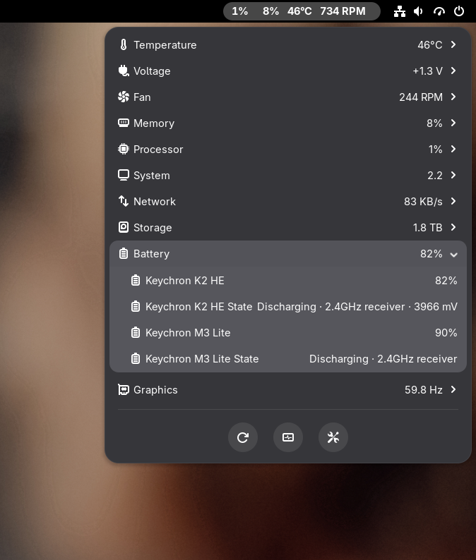

# Keychron Vitals

Read **Keychron M3 Lite mouse** and **K2 HE ANSI keyboard** battery levels on
Linux, from the console or in the Vitals GNOME Shell extension. Vitals can
show both percentages in the top bar and either device in its Battery summary.

The mouse works with stock firmware. **The keyboard requires the experimental
custom firmware patch** described in [the flashing and rollback guide](FLASHING.md).
The installer never flashes firmware.



## Console — no Vitals or tray app required

Clone this repository and run Python 3:

```sh
python3 battery.py
python3 battery.py --device keyboard
python3 battery.py --device mouse --json
```

Example output:

```text
Keychron M3 Lite: 90% — Discharging, 2.4GHz receiver
Keychron K2 HE: 82% — Discharging, 2.4GHz receiver, 3967 mV
```

The command queries devices directly, without a running service, GNOME, Python
GObject, hidapi, or a GUI. It prints percentage, charging state, connection and
keyboard voltage. JSON contains readings and errors. Exit status is 1 if any
requested device is unavailable. Device permissions are still required;
see [INSTALL.md](INSTALL.md). Wake the devices before querying. The keyboard
query takes about four seconds to collect receiver push reports.

## Vitals installation

For **niri with DMS**, both device readings appear inside the existing
Battery view, with charging and connection details and no separate bar icon.
See
[niri / DMS integration](dms/README.md) for prerequisites and removal.

Requires Linux with GNOME, [Vitals](https://github.com/corecoding/Vitals), Python
3 with `gi`, systemd, udev, and `gnome-extensions`.

```sh
git clone https://github.com/nwadams/keychron-vitals.git
cd keychron-vitals
/usr/bin/python3 install_vitals.py
```

Run as your desktop user; sudo is used only for the narrow device access rule.
Log out and back in to load changed GNOME Shell modules. The installer enables
Battery, pins both Keychron percentages while preserving other pins, and selects
**Keychron K2 HE** under Battery Preferences → Display Battery. Select
**Keychron M3 Lite** there to use the mouse for the collapsed summary instead.
A stock/unavailable keyboard shows N/A. Both rows also have a State entry.

The mouse service polls every 30 seconds. A separate keyboard service listens
for reports and queries wired keyboards about every five seconds. Vitals reads
atomic local JSON asynchronously, so hardware queries never block Shell.
Failed polls can retain the last reading for three minutes, marked “last known”;
expired, malformed or stopped-service data displays N/A.

See [INSTALL.md](INSTALL.md) for setup, updates, verification and removal.
Keep the checkout at its installed path; the services use absolute paths.

## Flashing and rollback

Follow [FLASHING.md](FLASHING.md) for the complete K2 HE ANSI procedure:
compile the pinned source, enter DFU, back up internal flash, prepare a preserving
image, flash and verify it, then test battery reports. The same guide includes
byte-for-byte rollback to your original backup and recovery notes.

## Supported hardware

| Device | USB ID | Transport / firmware |
| --- | --- | --- |
| M3 Lite via Link-KM | `3434:d026` | 2.4 GHz, stock |
| Wired M3 Lite | `3434:d04e` | USB, stock |
| K2 HE ANSI via Link-KM | keyboard `3434:0e20`, receiver `3434:d026` | 2.4 GHz, custom patch |
| Wired K2 HE ANSI | `3434:0e20` | USB, custom patch |

Bluetooth and other keyboard models are not implemented in this integration.
The keyboard's percentage is a voltage-derived estimate: charging can inflate
it, and early startup reports can still contain the firmware default. Allow
sampling to settle and compare the unplugged reading with Fn+B LEDs.

The K2 HE patch was compiled, flashed, read back byte-for-byte and tested
locally: receiver reports showed 84–85%, 3987–3992 mV, discharging; the user's
Fn+B LEDs agreed and typing worked. USB reported charging at 4098 mV.
Details, build/flash/recovery instructions and limitations are in
[research/KEYBOARD.md](research/KEYBOARD.md). Long-term sleep/wake is untested.

## Related project and contribution

[Keyboard Companion](https://github.com/OutersGIT/keyboard-companion) and its
[K10 HE firmware](https://github.com/OutersGIT/k10he-battery-firmware) provided
the custom A4 battery protocol and wireless push approach used for this K2 HE
port. See [our Keyboard Companion fork](https://github.com/nwadams/keyboard-companion)
for the Linux diagnostic, HID report-length fix and K2 HE validation contribution.
The contribution is submitted as [upstream PR #1](https://github.com/OutersGIT/keyboard-companion/pull/1).
The Windows tray app was not tested here. Do not flash K10 HE/Q1 HE binaries
onto a K2 HE.

## Development

```sh
python3 -m unittest discover -s tests -v
```

Tests cover mouse decoding and receiver checks, keyboard A4 decoding, charging,
cache expiry, atomic files, upgrades from older Vitals hooks, and real async GJS
reads for both summary selections. GJS checks skip when GJS is absent; hardware
is not required. See [protocol-evidence.json](protocol-evidence.json) for the
mouse protocol source. No configuration/pairing commands are used for polling.

App code is MIT licensed. The firmware patch is GPL-2.0-or-later; see
[research/firmware/LICENSE](research/firmware/LICENSE). Vitals retains its own
license and is copied locally by the installer rather than redistributed.
